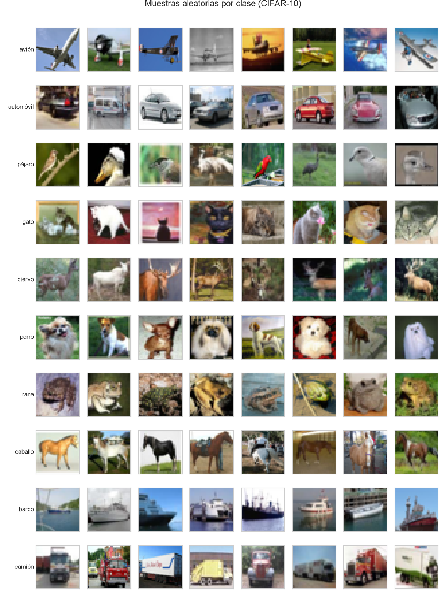
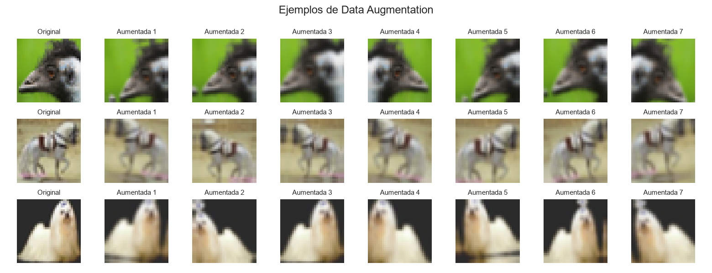
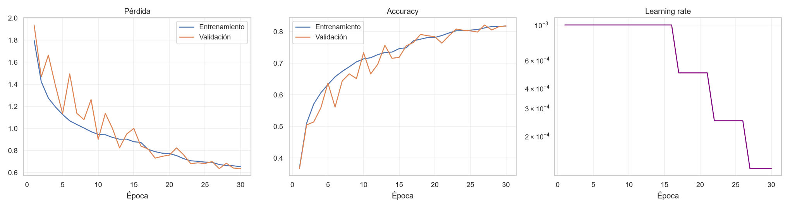
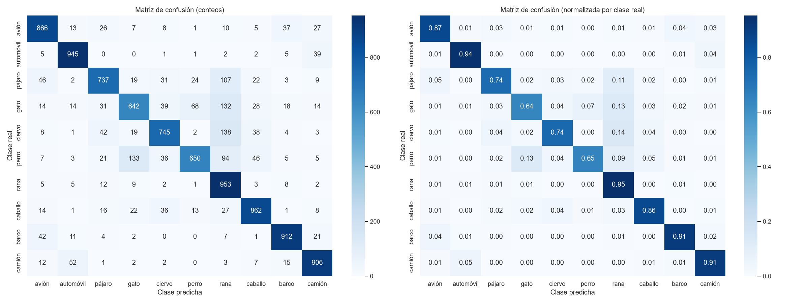
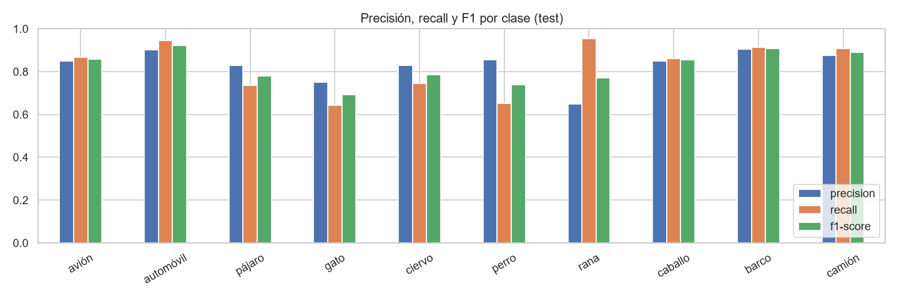
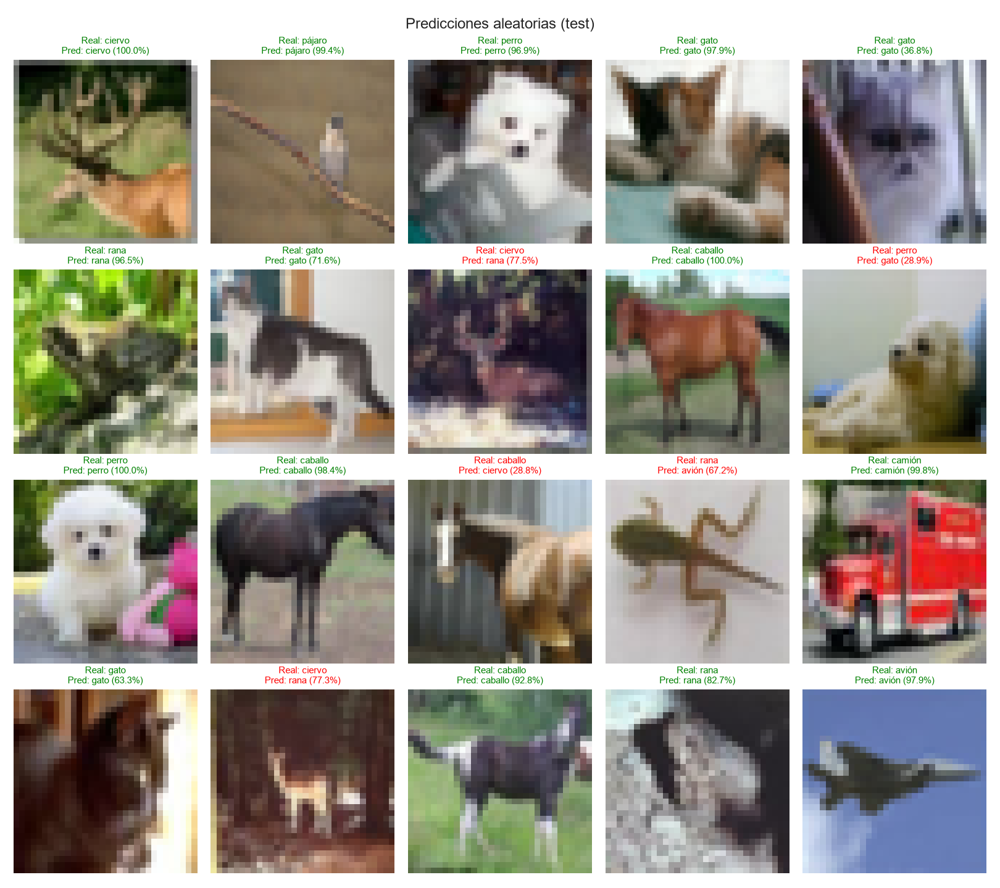

# 🧠 Clasificación de imágenes con CNN — CIFAR-10

Proyecto de Deep Learning que entrena una **Red Neuronal Convolucional (CNN)** para clasificar imágenes del dataset **CIFAR-10** en 10 clases. Incluye una aplicación **Streamlit** para cargar una imagen y obtener la clase predicha con su nivel de confianza.

| | |
|---|---|
| **Problema** | Clasificación multiclase de imágenes (10 clases) |
| **Dataset** | CIFAR-10: 60 000 imágenes RGB de 32×32 |
| **Modelo** | CNN tipo VGG (3 bloques conv + BatchNorm + Dropout + L2), ~307 mil parámetros |
| **Framework** | TensorFlow / Keras 3 |
| **Resultado en test** | **Accuracy 82.18 %** · F1 macro 0.8202 · Top-3 96.69 % · ROC-AUC 0.9838 |

---

## 📁 Estructura del repositorio

```
cnn-cifar10-clasificador/
├── notebooks/
│   └── CNN_CIFAR10_Experimentacion.ipynb   # Notebook completo (Colab) ejecutado con resultados
├── src/
│   ├── config.py      # Rutas, clases e hiperparámetros
│   ├── data.py        # Carga, normalización, división y preprocesamiento
│   ├── model.py       # Arquitectura CNN + Data Augmentation
│   ├── evaluate.py    # Métricas, gráficas y matriz de confusión
│   ├── train.py       # Script de entrenamiento
│   └── predict.py     # Script de predicción por línea de comandos
├── app/
│   ├── streamlit_app.py   # Aplicación web
│   └── sample_images/     # Imágenes de ejemplo para probar la app
├── models/
│   ├── cnn_cifar10.keras  # Modelo entrenado
│   └── class_names.json
├── reports/
│   ├── figures/           # Gráficas generadas
│   ├── history.csv        # Historial de entrenamiento
│   └── metrics.json       # Métricas en test
├── requirements.txt
└── README.md
```

---

## 🚀 Instrucciones de ejecución

### 1. Clonar e instalar dependencias

```bash
git clone <URL_DEL_REPOSITORIO>
cd cnn-cifar10-clasificador

python -m venv .venv
# Windows
.venv\Scripts\activate
# Linux / macOS
source .venv/bin/activate

pip install -r requirements.txt
```

> Requiere Python 3.10 – 3.13.

### 2. Ejecutar la aplicación Streamlit (usa el modelo ya entrenado)

```bash
streamlit run app/streamlit_app.py
```

Se abrirá `http://localhost:8501`. Sube una imagen (JPG/PNG) o elige una de ejemplo. La app muestra:
- la **clase predicha**,
- la **confianza** (probabilidad softmax), con un aviso si es < 50 %,
- un gráfico con la **probabilidad de cada clase**.

### 3. Predicción por línea de comandos

```bash
python -m src.predict app/sample_images/3_gato_1.png --top-k 3
```

### 4. Re-entrenar el modelo (opcional)

```bash
python -m src.train                 # entrenamiento completo (30 épocas máx., early stopping)
python -m src.train --epochs 5      # prueba rápida
python -m src.train --no-augment    # sin Data Augmentation (para comparar)
```

Genera `models/cnn_cifar10.keras`, `reports/metrics.json`, `reports/history.csv` y las figuras de `reports/figures/`.

### 5. Notebook de experimentación

- **Google Colab:** subir `notebooks/CNN_CIFAR10_Experimentacion.ipynb` (o abrirlo desde GitHub con *Archivo → Abrir cuaderno → GitHub*), activar GPU y ejecutar todo. El notebook es autocontenido y al final descarga un `.zip` con el modelo y las figuras.
- **Local:** `jupyter notebook notebooks/CNN_CIFAR10_Experimentacion.ipynb`

---

## 🔬 Metodología

### 1. Dataset
**CIFAR-10** (Krizhevsky, 2009): 60 000 imágenes a color de 32×32 en 10 clases balanceadas: *avión, automóvil, pájaro, gato, ciervo, perro, rana, caballo, barco, camión*. Se descarga automáticamente (espejo oficial de Hugging Face `uoft-cs/cifar10`, con `tf.keras.datasets` como respaldo).



### 2. Preprocesamiento
- Conversión a `float32` y normalización de píxeles a **[0, 1]**.
- Etiquetas enteras + `sparse_categorical_crossentropy`.
- En inferencia: conversión a RGB → redimensionado a 32×32 → normalización (misma función en `src/data.py`, notebook y app).

### 3. División de datos
| Conjunto | Imágenes | Uso |
|---|---|---|
| Entrenamiento | 45 000 | ajuste de pesos |
| Validación | 5 000 (estratificado) | early stopping, reducción de LR, selección del mejor modelo |
| Prueba | 10 000 (test oficial) | evaluación final |

### 4. Data Augmentation
`RandomFlip` horizontal, `RandomTranslation` ±10 %, `RandomRotation` ±18°, `RandomZoom` ±10 %, integrado como capas del modelo (solo activo en entrenamiento).



### 5. Arquitectura
```
Input 32×32×3 → Augmentation
→ [Conv3×3(32)  → BN → ReLU]×2 → MaxPool → Dropout 0.2
→ [Conv3×3(64)  → BN → ReLU]×2 → MaxPool → Dropout 0.3
→ [Conv3×3(128) → BN → ReLU]×2 → MaxPool → Dropout 0.4
→ GlobalAveragePooling → Dense(128) → BN → ReLU → Dropout 0.5 → Dense(10, softmax)
```
Optimizador Adam (lr = 1e-3), L2 = 1e-4, batch 64, callbacks `ModelCheckpoint`, `EarlyStopping` (paciencia 8) y `ReduceLROnPlateau`.

---

## 📊 Resultados

### Métricas globales en el conjunto de prueba (10 000 imágenes)

| Métrica | Valor |
|---|---|
| **Accuracy** | **82.18 %** |
| **Top-3 Accuracy** | **96.69 %** |
| **Precision (macro)** | **82.92 %** |
| **Recall (macro)** | **82.18 %** |
| **F1-Score (macro)** | **0.8202** |
| **ROC-AUC (OvR macro)** | **0.9838** |
| **Test Loss** | **0.6411** |

### Rendimiento por clase

| Clase | Precisión | Recall | F1-Score |
|---|---|---|---|
| ✈️ Avión | 84.99 % | 86.60 % | 0.8579 |
| 🚗 Automóvil | 90.26 % | 94.50 % | 0.9233 |
| 🐦 Pájaro | 82.81 % | 73.70 % | 0.7799 |
| 🐱 Gato | 75.09 % | 64.20 % | 0.6922 |
| 🦌 Ciervo | 82.78 % | 74.50 % | 0.7842 |
| 🐶 Perro | 85.53 % | 65.00 % | 0.7386 |
| 🐸 Rana | 64.70 % | 95.30 % | 0.7707 |
| 🐴 Caballo | 85.01 % | 86.20 % | 0.8560 |
| 🚢 Barco | 90.48 % | 91.20 % | 0.9084 |
| 🚚 Camión | 87.62 % | 90.60 % | 0.8909 |

**Análisis de resultados:**
- Los vehículos (**automóvil: 92.3 % F1**, **barco: 90.8 % F1**, **camión: 89.1 % F1**, **avión: 85.8 % F1**) logran los rendimientos más altos gracias a siluetas distintivas y fondos característicos (mar, asfalto, cielo).
- Las mayores confusiones se concentran entre animales domésticos de tamaño similar (**gato ↔ perro**) y entre herbívoros (**ciervo ↔ caballo**), una dificultad inherente a la resolución de 32×32 píxeles.
- La métrica **Top-3 Accuracy de 96.69 %** confirma que la categoría real se ubica casi siempre entre las 3 opciones más probables de la red.

### Curvas de entrenamiento


### Matriz de confusión


### Métricas por clase


### Predicciones sobre imágenes de prueba


---

## 🛠️ Tecnologías
Python · TensorFlow/Keras · NumPy · Pandas · scikit-learn · Matplotlib · Seaborn · Pillow · Streamlit
